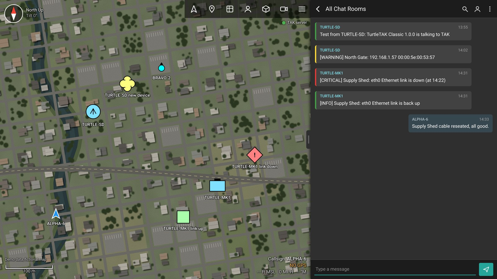
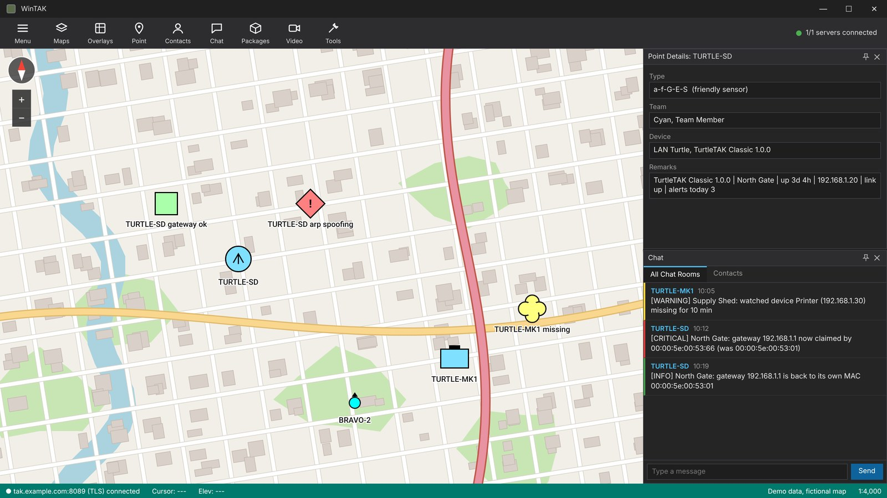
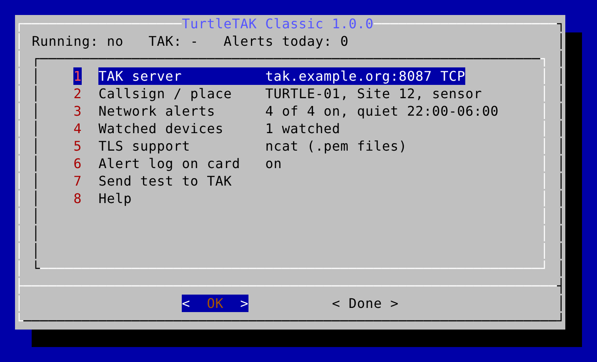

# TurtleTAK Classic – TAK modules for the Hak5 [LAN Turtle](https://docs.hak5.org/lan-turtle)

<p align="center"></p>

[](https://www.buymeacoffee.com/sect0101)

A LAN Turtle module that puts the **original Hak5 LAN Turtle** and the **LAN Turtle SD** on **TAK** (ATAK, WinTAK, iTAK, WebTAK, CloudTAK) as a facility sensor. The Turtle shows up on the map with its status, watches the wired network, and sends TAK alerts as markers and GeoChat.

**Modules here are written in Bash for the original LAN Turtle and the LAN Turtle SD. They are community modules and are not supported or guaranteed by Hak5.** See [Legal](#legal).

For the **LAN Turtle Hub**, use [TurtleTAK Hub Edition](https://github.com/SECT0101/TurtleTAK). Also see [PagerTAK](https://github.com/SECT0101/PagerTAK) for the WiFi Pineapple Pager and [SharkTAKDisplay](https://github.com/SECT0101/SharkTAKDisplay) for the Shark Jack Display.

---

## On the TAK map

<p align="center"> </p>

ATAK (left) and WinTAK (right): a LAN Turtle SD (TURTLE-SD, sensor marker) and an original LAN Turtle (TURTLE-MK1, facility marker), their alert markers and the same alerts in GeoChat. Mockups with demo data and a fictional map.

## Modules

| Edition | Device | Version | Description |
|---|---|---|---|
| [TurtleTAK Classic Edition](modules/turtletak) | LAN Turtle, LAN Turtle SD | 1.0.0 | The Turtle on TAK as a facility sensor, with a position and status marker; network watch alerts as TAK markers and GeoChat (new device, watched device missing / back, Ethernet link down / up, ARP spoofing) with quiet hours; TLS with a client certificate (`.pem` with the firmware's ncat, or `.p12` with openssl-util), or plain TCP / UDP; and on the LAN Turtle SD, an alert log on the card. Set up from the Turtle's own module menu. |

<p align="center"></p>

## Features

| Feature | What it does |
|---|---|
| **Sensor on TAK** | Every few minutes (5 by default), sends a CoT marker at the place you set: a sensor (`a-f-G-E-S`, the same as the Hub Edition) by default, or a facility, a team member in an ATAK team color, or any CoT type you enter. Its remarks show the site, uptime, the Turtle's LAN address, the Ethernet link and today's alert count. If reports stop, the marker goes stale, so a dead or unplugged Turtle shows on the map. |
| **Network watch** | Pings the Turtle's LAN (up to a /24) every few minutes and reads the ARP table every minute. The first pass after a start learns the LAN without alerts. |
| **Alerts** | **New device** (yellow). **Watched device missing** (yellow) and **back** (green). **Ethernet link down** (red) and **back up** (green). **ARP spoofing**: the gateway's IP claimed by another MAC (red), and **gateway restored** (green) when its real MAC is back. Each alert type can be turned off. |
| **Where alerts go** | A marker next to the Turtle that expires after an hour, and a line in **All Chat Rooms** (not during quiet hours). If TAK can't be reached, alerts are **queued** (up to 50) and sent when it's back, marked with the time they happened. |
| **TAK connection** | **TLS** with a client certificate, like ATAK: with the `ncat` already in the Hak5 firmware and `.pem` files (nothing to install), or with `openssl-util` and your `.p12` files and their passwords. Also plain **TCP** or **UDP** for servers that have those inputs. Warns 30 days before the client certificate expires. |
| **Alert log on the card** | LAN Turtle SD: TurtleTAK mounts the card's ext4 partition at `/sd` if it isn't mounted yet (it never formats anything), and every alert also goes to `turtletak/alerts.log` on the card, kept for the days you choose (90 by default). The original LAN Turtle has no card, so nothing is written to its flash while it runs. |
| **Turtle module** | One file in Hak5's module format. Set up in **Modules > turtletak > Configure**, run with **Start**, and start at boot with **Enable**. |

## Install

TurtleTAK Classic is one file, `turtletak`, that goes in `/etc/turtle/modules/` on the Turtle.

1. Download `turtletak` from [Releases](../../releases).
2. Copy it to the Turtle. Use `scp` (built into Windows 10 and 11, macOS and Linux) or WinSCP, so the file isn't changed on the way:
   ```
   scp turtletak root@172.16.84.1:/etc/turtle/modules/
   ssh root@172.16.84.1 chmod +x /etc/turtle/modules/turtletak
   ```
   `172.16.84.1` is the Turtle's address from the computer it's plugged into.
3. SSH to the Turtle. In the Turtle menu, open **Modules > turtletak > Configure**.

> If you pasted the file into an editor on Windows and the module doesn't show up or won't run, the file has Windows line endings. Fix it on the Turtle with:
> `tr -d '\r' < /etc/turtle/modules/turtletak > /tmp/t && cat /tmp/t > /etc/turtle/modules/turtletak`

## Setup

In **Configure**:

1. **TAK server**: host, port, and TLS, TCP or UDP. Most TAK Servers take TLS on port 8089 only; plain TCP and UDP (usually 8087) work only if your server has those inputs. For TLS, enter the server's **name as it is in its certificate**, not its IP address.
2. **Callsign / place**: the callsign, a site name, and where the Turtle is as decimal latitude and longitude. The Turtle has no GPS; long-press the spot in ATAK and copy its coordinates. Also how often it reports (minutes), then the **marker type**:

   | Choice | CoT type | In ATAK |
   |---|---|---|
   | Sensor (default) | `a-f-G-E-S` | Friendly ground sensor symbol, like the Hub Edition |
   | Facility | `a-f-G-I` | Friendly installation symbol, for a building or site |
   | Team member | `a-f-G-U-C` | A dot like an ATAK user, in the **team color** you pick next |
   | Custom | what you enter | Any CoT type shaped like `a-f-G-E-S`, for example `a-n-G-E-S` (neutral sensor) |
3. **Network alerts**: which alerts to send, whether to send them as GeoChat too, and quiet hours (no GeoChat between two times; markers still go to the map).
4. **Watched devices**: devices seen on the LAN now. Tick the ones that should always be there (a server, an NVR, a door panel), and set how long before one counts as missing (10 minutes by default). **Rename** gives a device a name, used in alerts.
5. **TLS support**: your certificates, and which TLS tool to use. See [TLS](#tls).
6. **Alert log on card**: only shown on a LAN Turtle SD with an ext4 card. See [SD card](#sd-card).
7. **Send test to TAK**: sends the marker and a GeoChat test line right away.
8. **Help**.

Then **Start** it, and **Enable** it to start at boot. The main menu shows whether it's running, the TAK connection and today's alert count.

## What TAK users see

| On the map / in chat | When | CoT type |
|---|---|---|
| The Turtle's marker, with its site, uptime, address, link and alert count in the remarks | every report interval | your marker type (`a-f-G-E-S` by default) |
| **ARP spoofing**, **link down** | when it happens | `a-h-G` (red) |
| **New device**, **watched device missing**, **certificate** expiring | when it happens | `a-u-G` (yellow) |
| **Device back**, **link up**, **gateway restored** | when it happens | `a-n-G` (green) |
| A GeoChat line in All Chat Rooms, for example `[CRITICAL] Site 12: gateway 192.168.1.1 now claimed by aa:bb:cc:00:00:66 (was aa:bb:cc:00:00:01)` | each alert, outside quiet hours | `b-t-f` |

Alert markers keep their own red, yellow and green types whatever the Turtle's marker type is. They sit next to the Turtle's marker, are linked to it, and expire after an hour. The Turtle's ID is `TurtleTAK-` plus the end of its MAC address, so it stays the same across restarts.

## TLS

TurtleTAK connects with a client certificate, like ATAK. There are two ways; **Configure > TLS support** shows which one your Turtle has.

| Way | Files | Install |
|---|---|---|
| **ncat** (in the Hak5 firmware, package `ncat-ssl`) | `.pem` files | Nothing |
| **openssl** (package `openssl-util`) | `.p12` files with their passwords, as for ATAK, or `.pem` files | Once, from the menu. The Turtle needs internet, and about 0.3 MB of free flash if the firmware already has `libopenssl` (1.3 MB if not) |

**With ncat (`.pem` files):**

1. On your TAK Server, which has `openssl`, turn the Turtle's `.p12` files into `.pem`:
   ```
   openssl pkcs12 -in turtle-sd.p12 -nodes -out turtle-sd.pem
   openssl pkcs12 -in truststore-root.p12 -nokeys -out truststore-root.pem
   ```
   Enter each file's password when asked. `turtle-sd.pem` holds the Turtle's certificate and its key, without a password; `truststore-root.pem` holds the CA.
2. Copy both to the Turtle:
   ```
   ssh root@172.16.84.1 mkdir -p /etc/turtletak/certs
   scp turtle-sd.pem truststore-root.pem root@172.16.84.1:/etc/turtletak/certs/
   ```
3. In **TLS support**, choose **Use .pem**, enter the two file names and leave the passwords empty. TurtleTAK checks the files right away and shows how many days the certificate has left.
4. In **TAK server**, enter the server's name (as in its certificate), the TLS port (usually 8089) and **TLS**.

**With openssl (`.p12` files):** in **TLS support**, choose **Install**, then copy the same `.p12` files you give ATAK to `/etc/turtletak/certs/` and enter their names and passwords.

The certificates are unpacked into RAM (`/tmp/turtletak/tls`) each time TurtleTAK starts. A `.pem` key has no password, so keep the Turtle itself secure, as you would a phone with ATAK on it, and revoke its certificate on the TAK Server if it's lost.

## SD card

On the LAN Turtle SD, TurtleTAK looks for an ext2, ext3 or ext4 partition on the card and mounts it at `/sd` when it starts. It never formats or repartitions anything. The Turtle's firmware can't read FAT cards (most new cards come as FAT), so a new card needs an ext4 partition first.

A card set up by Hak5's `extroot` module has partition 1 for ext4 and partition 2 for swap. If `block info` lists only the swap partition, partition 1 was never formatted. You can format it yourself; **this erases partition 1** (the swap on partition 2 stays):
```
mkfs.ext4 -F -L TURTLESD /dev/sda1
```
A blank card can be set up the same way with `fdisk` first, or on a computer.

## Files

| Where | What |
|---|---|
| `/etc/turtle/modules/turtletak` | The module |
| `/etc/config/turtletak` | Settings (kept across reboots) |
| `/etc/turtletak/certs/` | Your TLS `.p12` or `.pem` files |
| `/tmp/turtletak/` | While running: log (`turtletak.log`), state, queue, devices seen. In RAM, cleared at reboot |
| `/sd/turtletak/alerts.log` | Alert log on the SD card (LAN Turtle SD) |

Alert log lines look like this:
```
2026-11-24 15:02:55  CRITICAL arp spoofing    gateway 192.168.1.1 now claimed by aa:bb:cc:00:00:66 (was aa:bb:cc:00:00:01)
```

## Troubleshooting

| Problem | Check |
|---|---|
| `turtletak` isn't in the Modules list | The file must be in `/etc/turtle/modules/` and executable (`chmod +x`), with Unix line endings (see [Install](#install)). |
| Main menu says `can't reach` the server | The host and port, that the Turtle has a route to the server (it uses the Turtle's LAN connection), and the protocol: TCP 8087 and TLS 8089 are different ports. |
| TLS doesn't connect | **Send test to TAK** shows the error. `server certificate check failed` means the host doesn't match the server's certificate: enter the server's name, not its IP address. **TLS support** says if a password is wrong or a `.pem` is missing its key. See `/tmp/turtletak/turtletak.log`. |
| No new-device alerts | The first pass after a start only learns the LAN. Devices that answer neither ping nor ARP can't be seen. |
| A device I know about alerts as new | Tick it in **Watched devices** or give it a name with **Rename**: named and watched devices are never reported as new. |

## Repository layout

```
modules/
└── turtletak               # the module: one Bash file for /etc/turtle/modules/
docs/
├── logo.png                # TurtleTAK Classic Edition
├── menu-main.png           # the Configure menu (demo data)
└── atak-classic.jpg, wintak-classic.jpg  # what TAK users see (mockups, demo data)
.github/
├── FUNDING.yml             # Buy Me a Coffee (Sponsor button)
└── workflows/              # shellcheck on every push; turtletak attached to every release
```

The layout matches [hak5/lanturtle-modules](https://github.com/hak5/lanturtle-modules), so the module can be offered there as it is.

## Requirements

- An original LAN Turtle or LAN Turtle SD, with the stock Hak5 firmware
- A TAK Server, with a client certificate and truststore for the Turtle
- For TLS: `ncat-ssl` (in the Hak5 firmware) with `.pem` files, or `openssl-util` for `.p12` files

## Legal

Use this module only on networks you own or are explicitly authorized to monitor. You are responsible for complying with all applicable laws and policies. This project is not affiliated with or endorsed by Hak5 or the TAK Product Center.

## License

[GPL-3.0](LICENSE).
